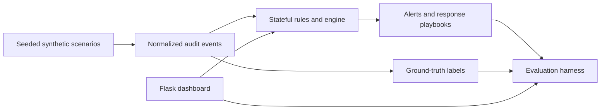
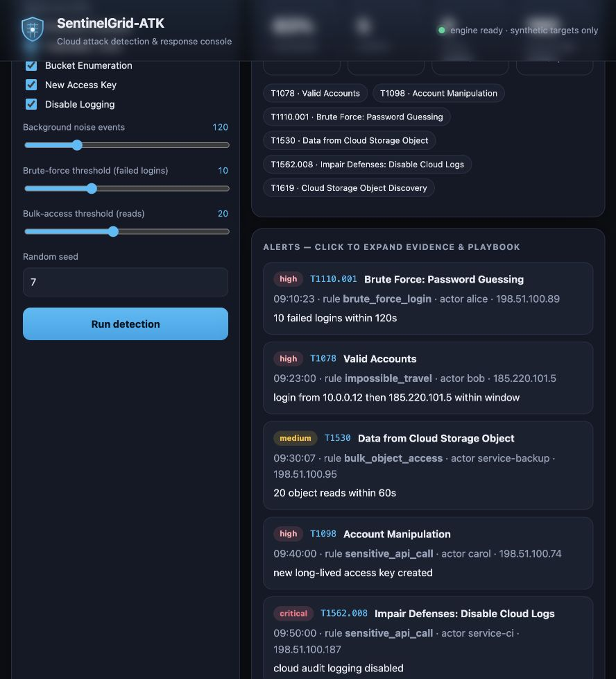

# SentinelGrid-ATK

Stateful cloud-audit detections with a local dashboard and an evaluation harness for measuring coverage, false alerts, and alert latency on generated scenarios.

[](https://github.com/harshacreate/SentinelGrid-ATK/actions/workflows/ci.yml)

## Problem / why it matters

Cloud audit streams contain routine actions alongside events that may indicate credential abuse, data access, persistence, or disabled logging. A rule needs to show both that it fires on the intended behavior and how often it is noisy on its evaluation set. This lab makes those checks repeatable with synthetic, labeled scenarios; it does not connect to a cloud account.

## What I built

The dashboard lets a user choose scenarios and adjust thresholds, then calls the same detection engine and scoring code used by the command-line evaluation. Rules consume normalized events without reading the ground-truth labels; the harness uses those labels only after alerting to score scenario coverage, false alerts, and latency.



The implementation covers failed-login bursts, rapid object reads, a second login IP within a short window, access-key creation, and audit logging being stopped. ATT&CK identifiers are labels for the modeled scenarios, not proof that the simplified events match a real provider schema.

### Dashboard



## Results / evaluation

**SYNTHETIC only.** Measured locally with `python3 -m harness.evaluate --seeds 20` (base seed 7, seeds 7–26):

| Measure | Result |
|---|---:|
| Generated scenario coverage | 100% mean; 100% worst seed |
| False alerts | 0 total across 20 runs |
| Mean alert latency | 5.18 seconds |
| Unit tests | 6 passed |

Coverage is the fraction of the five generated attack scenarios with at least one matching alert. It does not estimate production detection performance or behavior outside this generator.

## What I learned / design decisions I made

- Windowed rules keep per-actor timestamps in deques; thresholds are explicit inputs that can be tuned and regression-tested.
- Ground-truth fields are kept out of rule conditions and used only by the evaluator.
- The `impossible_travel` rule checks for a different source IP inside a time window; it does not perform geolocation or distance calculations.
- A single synthetic generator makes the run reproducible, but also limits what the score can say. A next step is an adapter for a documented public audit-log dataset or provider-shaped fixture, with its license and field mapping recorded.

## Run it

### Docker dashboard

```bash
docker compose up --build
# Open http://127.0.0.1:8091
```

### Local tests and evaluation

```bash
python3 -m venv .venv
source .venv/bin/activate
python -m pip install -r requirements.txt
make test
make eval
```

The evaluator is also available as JSON with `make eval-json`. The optional OpenSearch lab is separate and is not required for the detector or metrics.

## Limitations & next steps

The generated events are not CloudTrail or Azure Activity records, the rule set is small and hand-coded, and the labels simplify attacker behavior. Thresholds and IP-change logic are demonstrations, not deployment-ready rules. Next steps are schema adapters, benign replay data with documented provenance, rule-level precision/recall analysis, and analyst feedback on playbook steps.

The dashboard and evaluator run locally. No scan, exploit, credential, or third-party system interaction is performed.
